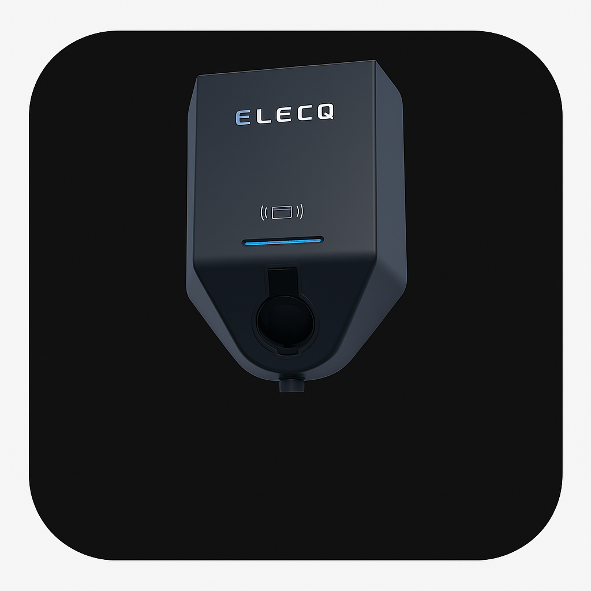

# Elecq AU101/AE106 OCPP – Home Assistant Custom Integration

<p>
  
</p>

[](https://gitea.ap6.xyz:3000/home/elecq-ocpp-ha)
[](https://www.home-assistant.io/)

---

# ⚡ Elecq AU101/AE106 OCPP Integration

A Home Assistant integration for the **Elecq AU101/AE106** EV Charger using an embedded **OCPP 2.0.1 WebSocket server**.  This project was developed for AU101, but a user report indicates it also works on AE106.

This integration provides:

- Real-time **charger status**
- EV **plugged-in** detection
- Detailed **charging state** (`Charging`, `SuspendedEV`, `Idle`, etc.)
- **Start/Stop charging** with true OCPP commands
- Accurate power and energy tracking
- Greyed-out switch while waiting for charger responses
- No cloud required — fully local

---

# 🖼 Integration Logo (Smaller)

<p>
  
</p>

---

# 🚀 Features

### 🟢 Charger Status
- Available / Occupied / Faulted / Unavailable

### 🔌 EV Plug Detection
- Instant plug/unplug recognition  
- Uses `stoppedReason: EVDisconnected` for accuracy

### 🔋 Charging State
- Real Charging
- EVConnected
- SuspendedEV → **Possibly fully charged**
- Idle / Finished

### ⚡ Energy Metrics
- Real-time Power (kW)
- Smoothed Power
- Total Energy (kWh)
- Session Energy

### 🆘 Smart Charging Switch
- Reflects *actual* charger state  
- Grey-out while awaiting OCPP response  
- Safe rejection when EV is full or unplugged  

---

# 📦 Installation

## Option A — HACS / Marketplace

HACS and the Home Assistant Marketplace only install from **public GitHub**
repositories. This project is hosted on Gitea, so they cannot install it
directly. Use **Option B** below, or a Gitea-aware installer such as HAIGS.

If you keep a GitHub mirror of this repository, add that mirror's URL to HACS
instead and select category: **Integration**.

---

## Option B — Manual Installation

Copy:

```
custom_components/elecq_ocpp
```

into:

```
<config>/custom_components/elecq_ocpp/
```

Restart Home Assistant.

---

# 🔧 Configuration

Open **Settings → Devices & Services → Add Integration → Elecq OCPP**

| Field | Meaning |
|-------|---------|
| Port | WebSocket port (default `9006`) |
| ID Token | Used in RequestStartTransaction |
| EVSE ID | Typically `1` |
| Connector ID | Typically `1` |

---

# 🔗 Elecq Charger OCPP Setup

In the Elecq mobile app, set:

```
ws://<home-assistant-ip>:9006/<charger-serial>
```

OCPP Version: **2.0.1**

---

# 🧩 Entities

The integration always creates the same core entities. Entity IDs use the device name
`Elecq AU101 Charger`, so each ID is prefixed with `elecq_au101_charger_`.

### Sensors
- `sensor.elecq_au101_charger_power`
- `sensor.elecq_au101_charger_power_smoothed`
- `sensor.elecq_au101_charger_total_energy`
- `sensor.elecq_au101_charger_session_energy`
- `sensor.elecq_au101_charger_charger_status` (registry name "Charger Status", hence `charger_charger`)
- `sensor.elecq_au101_charger_info` (charging state; registry name "Info")
- `sensor.elecq_au101_charger_current_l1`
- `sensor.elecq_au101_charger_current_l2`
- `sensor.elecq_au101_charger_current_l3`
- `sensor.elecq_au101_charger_voltage`
- `sensor.elecq_au101_charger_frequency`
- `sensor.elecq_au101_charger_temperature`
- `sensor.elecq_au101_charger_power_factor`
- `sensor.elecq_au101_charger_effective_limit`
- `sensor.elecq_au101_charger_meter_values` (diagnostic)

### Binary Sensors
- `binary_sensor.elecq_au101_charger_plugged_in`
- `binary_sensor.elecq_au101_charger_charging`

### Switch
- `switch.elecq_au101_charger_remote_charging`

### Read-only telemetry

The new sensors are observations only. `Effective Limit` comes from the charger's
`GetCompositeSchedule` response and exposes the schedule periods; if the charger
rejects the query, its `status` attribute explains why. Raw sampled values are on
the diagnostic `Meter Values` sensor. The integration does not call
`SetChargingProfile` or `SetVariables`, so the charger's own Power Monitor remains
in control.

---

# 🖥 Dashboard

A ready-to-paste dashboard ships with the integration. It uses only built-in Home
Assistant cards and the default entity IDs above. The Telemetry section shows the
effective limit and live electrical values read-only.

## Install (UI)

1. Go to **Settings → Dashboards → Add dashboard → New dashboard from scratch**.
2. Open the new dashboard, select **Edit dashboard**, and take control if prompted.
3. Open the three-dot menu and choose **Raw configuration editor**.
4. Replace everything with the contents of
   `custom_components/elecq_ocpp/dashboards/elecq_ocpp.yaml`.
5. Select **Save**.

The file is installed with the integration. You can also copy it from GitHub:
[elecq_ocpp.yaml](https://gitea.ap6.xyz:3000/home/elecq-ocpp-ha/src/branch/main/custom_components/elecq_ocpp/dashboards/elecq_ocpp.yaml).

## Install (YAML mode)

If you manage dashboards in YAML, copy the file to `dashboards/elecq_ocpp.yaml` in
your Home Assistant config folder, then add:

```yaml
lovelace:
  dashboards:
    elecq:
      mode: yaml
      title: Elecq
      icon: mdi:ev-station
      show_in_sidebar: true
      filename: dashboards/elecq_ocpp.yaml
```

## Notes

- The dashboard uses **sections** with **heading cards**, which requires Home Assistant **2024.10** or newer
  (heading cards were added in 2024.10).
- The gauge maximum is `22` kW, matching the AE104. If your charger is 7.4 kW or 11 kW,
  change `max: 22` in the gauge card to `7.4` or `11` so the gauge reads usefully.
- If you renamed the device or any entity, update the nine IDs in the YAML (or use your
  own entity IDs). The defaults are listed in the Entities section above.

---

# 🛠 Development

```bash
git clone https://gitea.ap6.xyz:3000/home/elecq-ocpp-ha.git
```

---

# 🏷 Versioning

- Follows Semantic Versioning  
- Version must match `manifest.json`  
- Releases should follow `vX.Y.Z`

---

# 📄 License

MIT License © 2025 **BashTheDog**
