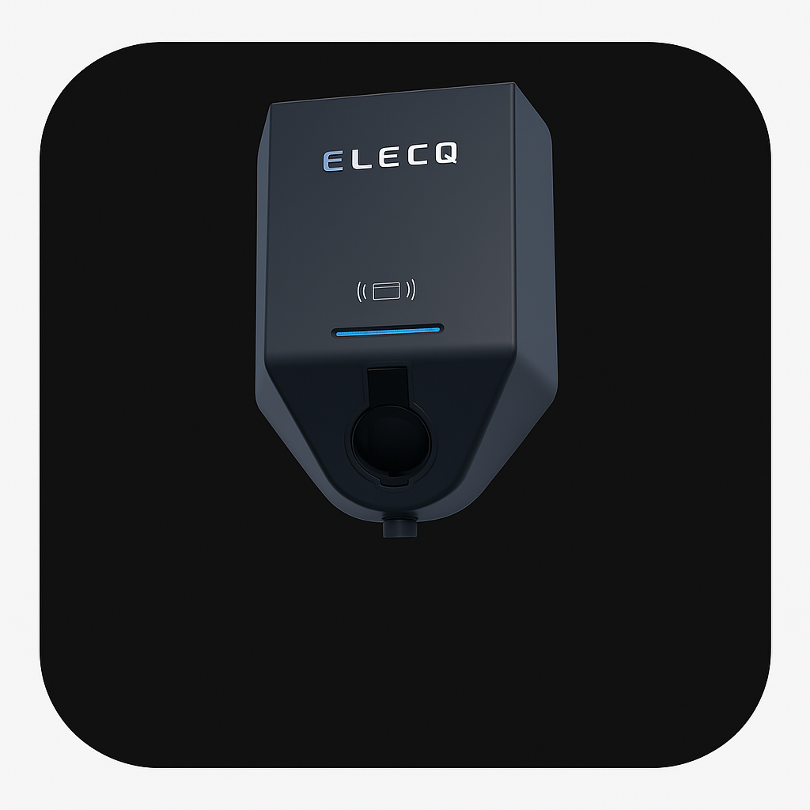

# Elecq AU101 OCPP – Home Assistant Integration



A fully local Home Assistant integration for the **Elecq AU101** EV Charger using an embedded **OCPP 2.0.1 WebSocket server**.

This integration enables real-time OCPP communication:
- Charging status
- Plugged-in state
- Power & energy metrics
- Remote start/stop
- Full OCPP 2.0.1 transaction handling
- No cloud dependency
- Grey-out switch while waiting for responses

## Installation

This project is hosted on Gitea:

```
https://gitea.ap6.xyz:3000/home/elecq-ocpp-ha.git
```

HACS and the Marketplace only install from public GitHub, so copy
`custom_components/elecq_ocpp` into your Home Assistant config folder and
restart. See the README for the full steps.

## Configuration

After installation:
- Go to Settings → Devices & Services → Add Integration → Elecq OCPP
- Configure:
  - Port (default 9006)
  - ID Token
  - EVSE ID (1)
  - Connector ID (1)

## Charger Setup

Configure your Elecq AU101 charger with:

```
ws://<home-assistant-ip>:9006/<charger-serial>
```

OCPP Version: **2.0.1**

## Entities

### Sensors
- Status
- Charging State
- Power
- Smoothed Power
- Total Energy
- Session Energy

### Binary Sensors
- Plugged In
- Charging

### Switch
- Remote Charging Control

## Dashboard

A ready-to-paste dashboard using only built-in Home Assistant cards ships with the integration.
Paste `custom_components/elecq_ocpp/dashboards/elecq_ocpp.yaml` into a new dashboard's raw configuration editor.
See the README for installation steps and the 22 kW gauge adjustment.

## Support

Issues & feature requests:  
https://gitea.ap6.xyz:3000/home/elecq-ocpp-ha/issues

## License

MIT License © 2025 BashTheDog
